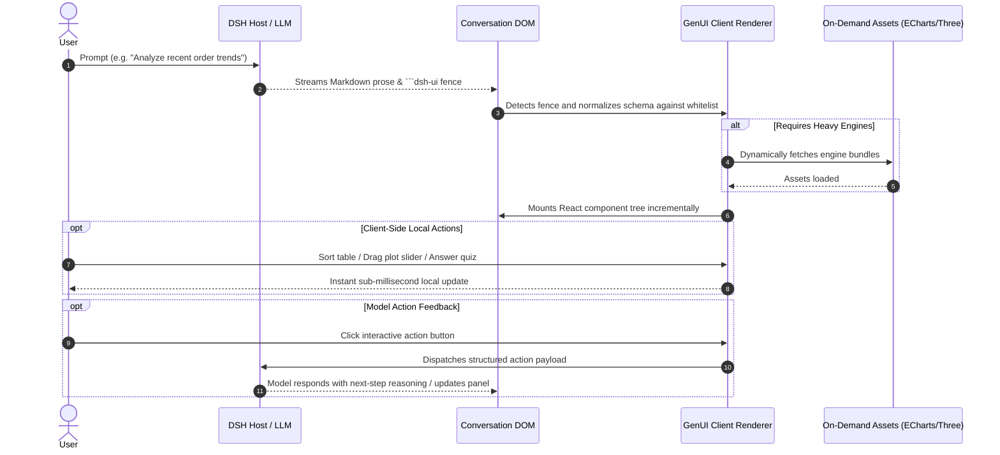

<div align="center">


<p align="center">
  <strong>Generative UI for DeepSeek Harness (DSH)</strong><br>
  Interactive, rich components rendered inline alongside the model's textual responses.
</p>

[](https://www.npmjs.com/package/@changfenhuang/dsh-genui)
[](https://github.com/omdsh-dev/dsh-genui)
[](LICENSE)
[](https://www.typescriptlang.org/)
[](https://github.com/topics/dsh-plugin)

<p align="center">
  <strong>English</strong> · <a href="./README.zh-CN.md">简体中文</a>
</p>

<p align="center">
  <a href="https://omdsh-dev.github.io/dsh-genui/"><strong>🌐 Live Product Site</strong></a> · 
  <a href="#-real-interface-showcase"><strong>🎬 Real Demo</strong></a> · 
  <a href="#-quick-start"><strong>🚀 Quick Start</strong></a> · 
  <a href="#-capability-matrix"><strong>🧩 Feature Matrix</strong></a> · 
  <a href="./SKILL.md"><strong>📖 Component Syntax (SKILL.md)</strong></a>
</p>

</div>

---

`dsh-genui` turns DeepSeek Harness (DSH) assistant replies into **safe, fully interactive UI surfaces**.

Ask “How are this month’s orders doing?”, and instead of plain text or raw code blocks, the response streams out an **interactive sortable data table**, **audio/video players**, **draggable function plots**, **self-grading quizzes**, or a **persistent workspace dock** — all embedded seamlessly within the conversation.

---

## 🎬 Real Interface Showcase

> [!NOTE]
> **Real Interface Captures:** All recordings and screenshots below are captured directly from real DSH interface rendering — no conceptual mockups or faked pre-renders.

### 40-Second Walkthrough

<div align="center">

https://github.com/user-attachments/assets/f5db33ec-7471-4d4a-a85b-79c9962ab4ef

<p align="center">
  <a href="./assets/demo.mp4"></a>
  <br><em>(Click the thumbnail to download the <a href="./assets/demo.mp4">original MP4</a> if the GitHub video player fails to load. The prompt sequence is documented in <a href="./demo-prompts.md">demo-prompts.md</a>.)</em>
</p>

</div>

### Three Concrete Real Outputs

| 1. Monitoring Panel: Answer is the Dashboard | 2. Function Plot: Drag to Redraw Instantly | 3. Composable Hierarchy: Work Surface |
| :--- | :--- | :--- |
|  |  |  |
| **Data Insights:** Eyebrow stats, filterable/drill-down service table, grouped totals, and spark/ring cells directly live in the assistant reply. | **Zero-Latency Exploration:** `plot` draws mathematical curves; drag parameter sliders to re-calculate and redraw locally in real time. | **Structured Hierarchy:** Display quotes, stat cards, ring progress, and labeled chapter dividers composed declaratively by the model. |

---

## ✨ Before vs. After

| Scenario | Plain Text Response | With dsh-genui |
| :--- | :--- | :--- |
| **Business Overview** | “Revenue this month is ¥128,430 (+12.4% MoM); conversion rate is slightly dipping…” | One line of concise prose + 3 stat cards (revenue/orders/conversion), a trend chart, and a progress bar rendered right beside it. |
| **Data Exploration** | Type another prompt to ask the model to re-sort or filter. | Click table headers to **sort numbers locally**, or use the search box to filter rows in real time. |
| **Parameter Tuning** | Re-prompt the model and wait for another full generation. | Drag sliders to see curves update in **sub-millisecond speed** with animation preview. |
| **Next Actions** | Copy text and manually perform follow-up tasks elsewhere. | Click interactive action buttons (e.g. “Refresh”, “Switch View”) to trigger **bidirectional model event loops**. |

---

## 🚀 Quick Start

### 1. Prerequisites

Ensure your environment meets the following requirements:
- **DSH Version**: `^0.2.0-rc.1 || ^0.2.1-rc.1` (verified against `dsh-v0.2.0-rc.1` and `dsh-v0.2.1-rc.2`)
- **pnpm on PATH**: The `dsh plugin` CLI requires pnpm. If missing: run `corepack enable` or `npm i -g pnpm`, then **open a new terminal** and confirm `pnpm -v` prints a version number.

### 2. Install & Activate

Run a single command in your terminal (all dependencies are fetched automatically):

```sh
# Public npm package (works without an npm account)
dsh plugin --profile web add @changfenhuang/dsh-genui
```

> [!TIP]
> **Adding only as a Node package?** Run `npm install @changfenhuang/dsh-genui`. Note that `npm install` only adds the dependency and does not register the plugin with DSH; use the `dsh plugin add` command above for DSH integration.

### 3. Verify in 60 Seconds

1. Restart the DSH web service and **hard refresh** your browser (`Cmd + Shift + R` or `Ctrl + F5`).
2. In a **new conversation session**, send:
   ```text
   Use dsh-ui to draw a stats dashboard with a sortable service table.
   ```
3. **Expected result**: The reply renders an in-place interactive dashboard rather than a plain code block.
4. **Console activation check**: Open your browser Developer Tools Console and look for `[genui] client active; fence-channel=dom`.

---

> [!WARNING]
> ### ⚠️ Installation Pitfalls to Avoid
> 
> 1. **Watch the Package Scope (Crucial)**:
>    The package must be **`@changfenhuang/dsh-genui`**. npm hosts an unrelated, unscoped package named `dsh-genui` (a Vue/OpenTiny implementation by another maintainer); installing it will fail due to incompatible host peer dependencies.
> 2. **Do Not Use `link:` on a Freshly Cloned Directory**:
>    `link:` alone does not bundle or resolve peer assets (mermaid, three.js, React). Use npm for standard usage; reserve `link:` strictly for local development (see [Developer Guide](#-developer-guide)).
> 3. **Migrating from Legacy `@omdsh-dev`**:
>    If you installed from GitHub or the old org name before v0.9.2, clean up the stale key:
>    ```sh
>    dsh plugin --profile web remove @omdsh-dev/dsh-genui
>    dsh plugin --profile web add @changfenhuang/dsh-genui
>    ```

---

## 🧩 Capability Matrix

Every component and behavior is guarded by the strict `dsh-ui` specification. See [SKILL.md](./SKILL.md) for full JSON schema details.

```
dsh-genui Capabilities
├── 🌊 1. Streaming & Realtime Mounting
├── 🎨 2. 30+ Component Ecosystem
├── ⚡ 3. Local-First Responsiveness
├── 🔄 4. Bidirectional Action Event Loop
├── 📌 5. Persistent Session Workspace & Templates
└── 🛡️ 6. Sandboxing, Guards & Self-Healing
```

### 1. 🌊 Streaming & Realtime Mounting
- **Answer-as-UI**: Components stream into the conversation as tokens arrive, mounting incrementally without waiting for the full reply to finish.
- **Graceful Fallback**: If the plugin is absent or disabled, fences degrade cleanly to standard Markdown code blocks without breaking the chat history.

### 2. 🎨 30+ Component Ecosystem
- **Display & Typography**: Hero banner, Stat cards (`stat` with eyebrow labels, deltas, and sparklines), Tables, Timelines, Code Diffs, Step progress, File trees (interactive expand/collapse), Callouts, and Badges.
- **Advanced Tables**:
  - Click headers to **sort locally** (ascending / descending / reset) with smart parsing for numbers, currency, commas, percentages, and `k/m/b` units;
  - Columns support inline progress bars (`bar`), rings (`ring`), sparklines (`spark`), and badges;
  - One-click data export (Copy Markdown / CSV) and instant client-side text filtering (`filter`).
- **ECharts Integration (`echart`)**:
  - **Preset Mode**: Shorthand presets (`bar`, `line`, `area`, `pie`, `scatter`, `radar`, `gauge`, `funnel`, `treemap`, `sankey`, `graph`, `heatmap`, `bigline`, `wordCloud`) that adapt automatically to host light/dark themes;
  - **Full Option Mode**: Full native ECharts options for advanced features like DataZoom and VisualMap;
  - **On-Demand Lazy Loading**: The ~1 MB ECharts engine is loaded asynchronously only when an `echart` block is encountered.
- **Mathematical Function Plots (`plot`)**:
  - Multi-series plotting with expressions (trig, log, exp, power);
  - **Live Parameter Sliders**: Drag sliders to redraw curves instantly at 60 FPS; supports auto-animation loops.
- **Mermaid & 3D Visuals**: Flowcharts, sequence diagrams, and lightweight 3D models with on-demand asset loading.
- **Native Galleries**: `carousel` composes existing cards and forms in a responsive, keyboard-navigable horizontal track; `image-group` opens images in a local lightbox with focus restoration. Navigation does not invoke model actions. [Examples and verification](docs/gallery.md).
- **Native Media**: Inline playback for accessible audio and video URLs, with poster images, aspect ratios, and controls.
- **KaTeX Math Rendering**: Inline math (`$...$`) and display blocks (`$$...$$`), supporting matrices and multi-line equations.

### 3. ⚡ Local-First Responsiveness
- **Zero-Latency Interactions**: State transitions that the frontend can handle alone (sorting, filtering, accordion toggling, slider redraws, tab switches) execute **entirely client-side** without round-trips to the model.
- **Quizzes & Submission (`quiz` / `submit`)**:
  - Single quizzes evaluate instantly with explanations and retry options;
  - Multi-question assessments support batch grading and progress tracking with the `groups` schema.
- **Durable Persistence**: User inputs, form fields, and quiz states persist across page reloads via session fingerprints (LRU cache of 200 blocks).

### 4. 🔄 Bidirectional Action Event Loop
- **Closed-Loop Interactions**: Interactive elements equipped with an `action` payload package user events back to the model to trigger follow-up reasoning.
- **Honest UI Guarantee**: Buttons without an `action` render disabled to eliminate "dead clicks"; active buttons show immediate visual feedback upon trigger.
- **Debounced Delivery**: Discrete taps send immediately; continuous slider drags apply trailing-edge debounce to prevent message flooding.

### 5. 📌 Persistent Session Workspace & Templates
- **Session Dock Panel**: Open a persistent dock above the composer via `/panel` or `panel: true`; resize by dragging its border; append tabs incrementally with `append: true`.
- **Template Center & Badges**:
  - **Templates**: Browse 11 pre-built scenario templates directly from the dock to kickstart prompts;
  - **Achievements**: Unlock 12 built-in local exploration badges as you interact with various components.

### 6. 🛡️ Sandboxing, Guards & Self-Healing
- **Security by Design**: Strictly whitelisted JSON components; zero script injection or `eval`; **strict prohibition of passwords or secret collection**.
- **Same-Turn Fence Steering**: If a generated fence fails validation, diagnostic errors are fed back to the model within the **same turn** so it can self-correct (can be disabled via `fenceFeedback: false`).
- **Resilient Fallbacks**: Malformed nodes are safely discarded while siblings render normally (single node errors never crash the fence); Mermaid syntax glitches are automatically repaired.

---

## 💻 Quick Examples

### Example 1: Executive KPI Dashboard

The model emits the following `dsh-ui` code block:

```dsh-ui
{
  "title": "Q3 2026 Executive Overview",
  "items": [
    {
      "type": "row",
      "items": [
        { "type": "stat", "label": "Total Revenue", "value": "¥128,430", "delta": "+12.4%", "spark": [40, 55, 60, 85, 120] },
        { "type": "stat", "label": "Completed Orders", "value": "1,024", "delta": "-3.1%", "spark": [90, 85, 80, 75, 70] },
        { "type": "progress", "label": "Quarterly Target", "value": 82, "variant": "ring" }
      ]
    }
  ]
}
```

### Example 2: ECharts Revenue Trend

```dsh-ui
{
  "title": "Revenue Breakdown",
  "items": [
    {
      "type": "echart",
      "title": "Monthly Performance",
      "preset": "bar",
      "data": [
        { "label": "Jan", "value": 98 },
        { "label": "Feb", "value": 112 },
        { "label": "Mar", "value": 128 },
        { "label": "Apr", "value": 145 },
        { "label": "May", "value": 160 }
      ]
    }
  ]
}
```

> For the comprehensive specification and full component catalog, refer to [SKILL.md](./SKILL.md).

---

## ⚙️ Architecture & How It Works



### Artifact Exporting
Completed GenUI blocks can be exported on demand:
- **Standalone `.html`**: Inlines the lightweight renderer, CSS styles, KaTeX fonts, and required chart engines so the interactive UI can be viewed and tested offline in any browser.
- **`.genui.json`**: Retains the normalized specification and durable interaction states for storage and portability.

---

## 🧑‍💻 Developer Guide

### Local Development (Link Mode)

```sh
git clone https://github.com/omdsh-dev/dsh-genui.git
cd dsh-genui
pnpm install

# Build and link into your DSH web profile
dsh plugin --profile web add link:$PWD
```

### Useful Commands

```sh
pnpm run check           # Type checks + full unit test suite + build
pnpm run test            # Run Vitest unit tests
pnpm run check:host-api dsh-v0.2.1-rc.2  # Check the current published DSH API
node scripts/verify-pack.mjs --keep  # Verify and inspect npm tarball
```

### End-to-End (E2E) Testing

- **Visual E2E Smoke (No Model API Key Required)**:
  ```sh
  npx tsx scripts/e2e-visual.mts          # Boots headless Chrome, tests gallery rendering and asserts interactions
  ```
- **Real-Model Integration E2E**:
  ```sh
  export DSH_ROOT=/path/to/deepseek-harness-0.2.1-rc.2
  export DSH_BIN="$DSH_ROOT/apps/cli/lib/bin.js"
  DEEPSEEK_API_KEY=sk-... node scripts/e2e.mjs
  ```

### Advanced Profile Configurations

To customize plugin behaviors, add configurations under `cordis.patch.yml` in your profile:

```yaml
- id: genui
  name: '@changfenhuang/dsh-genui'
  config:
    renderUiTool: false   # Disable registering the render_ui tool card (fences and panel remain active)
    fenceFeedback: false  # Disable automatic same-turn steer correction on malformed fences
```

### Embedding into Other Applications

You can import `GenuiBlock`, `GenuiActionContext`, and `processGenuiSpec` from `@changfenhuang/dsh-genui/embed` to embed the renderer into any React application supporting CSS Modules.

---

### BetterSidebar side conversations (optional)

GenUI can render settled `dsh-ui` fences on an explicit BetterSidebar sidechat surface. This requires BetterSidebar's `registerSidechatSurfaceAdapter` service capability; an older or absent BetterSidebar keeps its original Markdown. No cross-plugin package import or main-conversation DOM attributes are required.

Actions use the owning child thread's existing prompt route, never the main conversation. Interaction state is isolated by source, thread, event, original text-block index and fence index. Streaming text remains Markdown until settled. `panel:true`, SVG, unlabelled fences and invalid or mismatched source/DOM content retain their original code blocks; this integration does not invent a sidechat panel dock.

See [the bounded surface contract and validation checklist](docs/sidechat-surfaces.md). This is a coordinated capability addition, not a claim that released BetterSidebar 0.28.0 already supports it.

## ❓ FAQ & Troubleshooting

<details>
<summary><strong>Q: Why are dsh-ui fences still showing up as raw code blocks?</strong></summary>

1. Open your browser Developer Tools (F12) and inspect the Console.
2. Search for the log `[genui] client active; fence-channel=dom`:
   - **If missing**: The client bundle was not activated by the host. Verify that `dsh plugin list` shows the plugin as active, restart DSH web, and hard refresh your browser;
   - **If present**: Check whether the code block language identifier is strictly `dsh-ui` and that its body contains valid JSON.
</details>

<details>
<summary><strong>Q: Error: "pnpm not found on PATH"?</strong></summary>

DSH plugin management calls `pnpm` under the hood. Run `corepack enable` or `npm i -g pnpm`, then **open a new terminal window** before running `dsh plugin add`.
</details>

<details>
<summary><strong>Q: npm install returns 404?</strong></summary>

The package is public and requires no login. Verify the package name via `npm view @changfenhuang/dsh-genui version`. If a version was published very recently, allow a few moments for registry mirrors to synchronize.
</details>

<details>
<summary><strong>Q: 3D scene, Mermaid, or ECharts does not render?</strong></summary>

Heavier engines are lazy-loaded through plugin-provided static routes upon their first appearance. Hard refresh your browser (`Cmd + Shift + R`). If the issue persists, reinstall the package:
```sh
dsh plugin --profile web remove @changfenhuang/dsh-genui
dsh plugin --profile web add @changfenhuang/dsh-genui
```
</details>

<details>
<summary><strong>Q: The chat screen goes blank when rendering a fence?</strong></summary>

This version strictly requires DSH `^0.2.0-rc.1 || ^0.2.1-rc.1`. Older host versions lack necessary React slot/context capabilities; please upgrade DSH.
</details>

---

## 🗺️ Roadmap Evaluation

| Exploration Area | Decision | Rationale |
| :--- | :---: | :--- |
| **Incremental Diff Patching** | Declined | A fence costs only 200–800 tokens; resending is fast and safe. Teaching models a patch diff protocol introduces high friction and hallucination rates. |
| **Granular Action Delivery** | ✅ Done | Discrete gestures send immediately; continuous slider drags apply trailing-edge debounce to keep chat context clean. |
| **Cross-Session Replay Persistence** | Declined | Resetting on replay is the more natural expectation when the model updates the UI; state is preserved seamlessly during streaming. |
| **Separate Gallery / i18n Strings** | Declined | The component gallery is covered by `demo-prompts`, `gallery.ts`, and README screenshots; the core bundle carries only 6 built-in UI strings. |

---

## 🔗 Links & Community

- [Linux.do Community Discussion](https://linux.do)
- Visit the [Live Product Site](https://omdsh-dev.github.io/dsh-genui/) to explore more demos.

---

## 📄 License

This project is licensed under the [MIT License](LICENSE).

### Native maps

The `map` node combines lazy MapLibre markers and inline routes with an
always-available keyboard-operable location list. Selection stays local and can
be persisted/submitted as a stable location ID through the existing fields
contract. The default is an offline blank coordinate map, not a street basemap;
external styles belong to trusted host configuration, never model JSON.
See [the map contract and embedding/export guide](docs/map.md).
