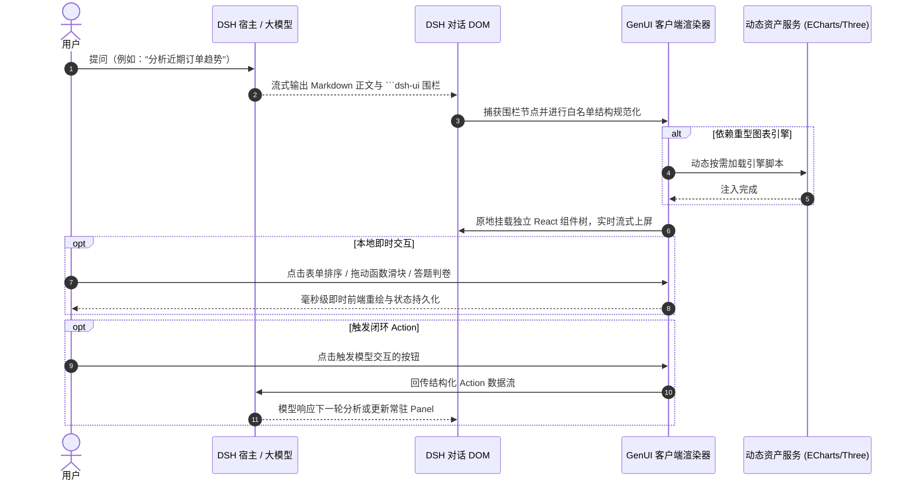

<div align="center">


<p align="center">
  <strong>为 DeepSeek Harness (DSH) 赋予原生交互式界面</strong><br>
  文字回答依旧完整，富交互组件即刻上线。
</p>

[](https://www.npmjs.com/package/@changfenhuang/dsh-genui)
[](https://github.com/omdsh-dev/dsh-genui)
[](LICENSE)
[](https://www.typescriptlang.org/)
[](https://github.com/topics/dsh-plugin)

<p align="center">
  <a href="./README.md">English</a> · <strong>简体中文</strong>
</p>

<p align="center">
  <a href="https://omdsh-dev.github.io/dsh-genui/"><strong>🌐 在线产品站</strong></a> · 
  <a href="#-真实界面预览"><strong>🎬 界面演示</strong></a> · 
  <a href="#-快速开始"><strong>🚀 快速开始</strong></a> · 
  <a href="#-核心能力全景"><strong>🧩 核心特性</strong></a> · 
  <a href="./SKILL.md"><strong>📖 组件语法 (SKILL.md)</strong></a>
</p>

</div>

---

`dsh-genui` 将大模型的文本回答无缝升级为**安全、可交互的原生 DSH 界面**。

例如当你询问「这个月订单表现如何？」，模型给出的回答不再只是一串文字，而是边打字边在正文中展开一张**可排序的数据面板**、一段**内嵌音视频**、一个**可拖拽调参的函数图像**、一组**即时判卷的测验**，或是一个**常驻的会话工作区**——文本与 UI 和谐共存，浑然一体。

---

## 🎬 真实界面预览

> [!NOTE]
> **真实截图与录屏：** 以下界面素材均直接截取自 DSH 真实对话环境中的渲染结果，无任何概念样机或预渲染伪造。

### 40 秒完整体验

<div align="center">

https://github.com/user-attachments/assets/f5db33ec-7471-4d4a-a85b-79c9962ab4ef

<p align="center">
  <a href="./assets/demo.mp4"></a>
  <br><em>（若 GitHub 视频播放器加载较慢，点击封面即可直接下载查看 <a href="./assets/demo.mp4">原始 MP4</a>；四幕测试提示词详见 <a href="./demo-prompts.md">demo-prompts.md</a>）</em>
</p>

</div>

### 回答中的三类典型输出

| 1. 监控面板：回答即仪表盘 | 2. 探索绘图：本地即时重绘 | 3. 结构排版：构建工作界面 |
| :--- | :--- | :--- |
|  |  |  |
| **数据洞察：** 指标卡（Eyebrow）、可筛选可钻取的服务表、分组合计与 Spark/Ring 单元格直接内嵌在回答中。 | **即时交互：** `plot` 绘制数学曲线；拖动参数滑块在浏览器端实时重绘，零模型往返延迟。 | **层级工作区：** 标题引言、指标卡片、环形进度与章节分隔线，由模型声明式灵活编排。 |

---

## ✨ 对比：装之前 vs 装之后

| 场景 | 传统纯文本回答 | 安装 dsh-genui 之后 |
| :--- | :--- | :--- |
| **业务监控** | “本月收入 ¥128,430，环比 +12.4%，转化率稍有下滑……” | 一行文字分析 + 紧贴正文的**收入/订单/转化率指标卡**、**动态趋势图**与**进度条**。 |
| **数据筛选** | 必须再发送一段提问要求模型重新生成表格。 | 表格自带**本地点击排序**与**实时过滤框**，无需重新请求模型。 |
| **深入探索** | 想要调整参数看趋势，必须反复调用模型对话。 | 拖动参数滑块，函数曲线在前端**毫秒级重绘**，带播放动画演示。 |
| **后续操作** | 复制文本自己另找工具处理。 | 面板自带「刷新」「切换视图」按钮，点击通过 **Action 闭环**驱动模型执行下一步。 |

---

## 🚀 快速开始

### 1. 环境准备

安装前请确认满足以下条件：
- **DSH 版本**：`^0.2.0-rc.1 || ^0.2.1-rc.1`（已在 `dsh-v0.2.0-rc.1` 与 `dsh-v0.2.1-rc.2` 上深度验证）
- **pnpm 处于 PATH 中**：`dsh plugin` 底层依赖 pnpm。如尚未安装，请执行 `corepack enable` 或 `npm i -g pnpm`，之后**重新打开终端**，确认 `pnpm -v` 可正常输出。

### 2. 一键安装与激活

在终端中执行以下命令（一键全自动拉取依赖）：

```sh
# 安装并激活至 DSH web profile（公开包，无需登录 npm）
dsh plugin --profile web add @changfenhuang/dsh-genui
```

> [!TIP]
> **仅作为依赖引入？** 若仅作为 Node 项目依赖引入而不注入 DSH 宿主，执行 `npm install @changfenhuang/dsh-genui` 即可。

### 3. 60 秒验证

1. 重启 DSH web 服务，并在浏览器中执行**硬刷新**（`Cmd + Shift + R` 或 `Ctrl + F5`）。
2. 在 DSH 中开启一个**新会话**，发送以下指令：
   ```text
   用 dsh-ui 画一个带可排序服务表的统计看板。
   ```
3. **预期效果**：回答中的代码块将实时转变为精美的交互式仪表盘，而非原样文本。
4. **控制台激活检测**：打开浏览器开发者工具 Console，若看到输出 `[genui] client active; fence-channel=dom`，说明客户端已成功激活。

---

> [!WARNING]
> ### ⚠️ 安装避坑指南
> 
> 1. **认准包名 Scope（极为关键）**：
>    必须安装 **`@changfenhuang/dsh-genui`**。npm 上存在一个同名但无 Scope 的 `dsh-genui`（由其他维护者基于 Vue/OpenTiny 开发，与本插件完全不兼容），如不慎安装会被 DSH 宿主因 peer 依赖冲突拒绝。
> 2. **切勿使用 `link:` 安装刚 git clone 的目录**：
>    纯 `link:` 不会自动安装 Mermaid、Three.js、React 等对等依赖，导致前端渲染报错。日常使用请走 npm 安装；仅本地源码开发时才使用 link（见[开发者指南](#-开发者指南)）。
> 3. **从旧包名 `@omdsh-dev` 迁移**：
>    若在 v0.9.2 之前使用过 GitHub 源或旧组织名安装，请执行：
>    ```sh
>    dsh plugin --profile web remove @omdsh-dev/dsh-genui
>    dsh plugin --profile web add @changfenhuang/dsh-genui
>    ```

---

## 🧩 核心能力全景

`dsh-genui` 的所有组件与交互受严格的白名单规范约束，兼顾丰富表现力与高安全性。完整字段定义见 [SKILL.md](./SKILL.md)。

```
dsh-genui 核心能力矩阵
├── 🌊 1. 边流边渲染 (Streaming UI)
├── 🎨 2. 30+ 丰富组件生态 (Components Matrix)
├── ⚡ 3. 本地优先即时交互 (Local-First Experience)
├── 🔄 4. 闭环事件回传系统 (Action Event-Loop)
├── 📌 5. 常驻会话工作台 (Session Panel & Templates)
└── 🛡️ 6. 安全沙箱与容错自愈 (Safety & Self-Healing)
```

### 1. 🌊 边流边渲染 (Streaming UI)
- **回答即界面**：组件内嵌在回复正文中，跟随模型 Token 流式吐出，边生成边即时挂载，**无需等待整段回复输出完毕**。
- **零破坏降级**：若未安装或禁用插件，`dsh-ui` 围栏将退回为优雅的 Markdown 代码块，绝不破坏会话内容。

### 2. 🎨 30+ 丰富组件生态 (Components Matrix)
- **展示与排版**：包含指标卡（`stat`，支持 Hero 超大字号与微趋势线 Sparkline）、表格（`table`）、时间线（`timeline`）、代码对比（`diff`）、步骤条（`steps`）、文件树（`file-tree`，支持点击展开折叠）、提示卡（`callout`）、徽章（`badge`）等。
- **高级表格**：
  - 点击表头**纯本地排序**（升序/降序/还原，支持千分位、百分比、货币及万/亿数值感知）；
  - 单元格支持 `bar` 进度条、`ring` 环形、`spark` 趋势线，带正负符号数值自动着色；
  - 一键支持数据导出（复制 Markdown / CSV）与即时文本过滤（Filter）。
- **ECharts 深度集成 (`echart`)**：
  - **预设简写模式**（`preset`）：支持 `bar`、`line`、`area`、`pie`、`scatter`、`radar`、`gauge`、`funnel`、`treemap`、`sankey`、`graph`、`heatmap`、`bigline`、`wordCloud` 等数十种图形，配色自动匹配 DSH 主题；
  - **完整配置模式**（`option`）：支持原生 ECharts 选项，轻松开启 DataZoom、VisualMap 等高级特性；
  - **按需异步加载**：ECharts 引擎（~1MB）独立打包，未调用图表组件的会话绝不加载多余代码。
- **数学函数绘图 (`plot`)**：
  - 支持多曲线绘制（line / area / scatter），公式支持三角函数、对数、幂运算等；
  - **动态参数滑块**：拖动滑块前端毫秒级重绘，锁定 Y 轴，支持自动动画循环演示。
- **Mermaid & 3D 场景**：支持流程图、序列图及轻量 3D 模型渲染，引擎按需异步加载。
- **原生多媒体**：支持浏览器可直达的音频（`audio`）与视频（`video`）嵌入播放，包含封面图、比例自适应及播放控制。
- **数学公式集成**：基于 KaTeX，支持行内公式 `$...$`、块级公式 `$$...$$`，支持矩阵与多行推导。

### 3. ⚡ 本地优先即时交互 (Local-First Experience)
- **本地优先原则**：前端界面能够独立完成的操作（表格排序、过滤、内容展开/收起、标签切换、参数重绘、测验判题），**一律在浏览器本地即时完成**，绝不进行不必要的模型往返。
- **测验与本地判卷 (`quiz` / `submit`)**：
  - 单题测验点击即在本地判题、展示解析并支持重试；
  - 多题问卷/表单可通过 `submit` 统一交卷，支持 `groups` 必填项控制与进度感知。
- **状态持久化**：表单输入、单选多选与测验进度基于「会话 + 内容指纹」自动存入缓存（LRU 200 块），刷新页面或重开会话无缝恢复。

### 4. 🔄 闭环事件回传系统 (Action Event-Loop)
- **真实动作闭环**：当按钮或表单带上 `action` 字段时，用户的点击或提交会即时组装为结构化事件回传给大模型，触发下一轮智能分析。
- **诚实交互设计**：未声明 `action` 的按钮自动渲染为禁用态，杜绝“看起来可点但无反应”的假交互；点击有效按钮触发即刻给予视觉反馈。
- **智能防抖**：按钮与切换项单次手势单次发送，连续滑块拖动自动开启尾沿防抖，仅回传最终停顿值。

### 5. 📌 常驻会话工作台 (Session Panel & Templates)
- **常驻 Dock 面板**：支持通过 `/panel` 指令或 `panel: true` 将 UI 固化在输入框上方；支持鼠标拖拽边框调整高度；支持 `append: true` 增量追加标签页。
- **模板中心与成就系统**：
  - **模板中心**：点击 Dock 顶部的「模板」即可预览 11 类典型业务场景模板，一键插词唤起模型；
  - **探索成就**：内置 12 项探索趣味成就，本地计数记录使用足迹。

### 6. 🛡️ 安全沙箱与容错自愈 (Safety & Self-Healing)
- **严格安全防线**：所有组件严格受白名单结构约束，杜绝一切外部代码注入与 `eval` 执行；**严禁索取与收集密码、API Key 等任何敏感凭据**，密码类输入强制打码且绝不持久化。
- **同回合轮内自修 (Fence Steer Repair)**：若模型生成的 `dsh-ui` 围栏存在格式缺陷，插件自动捕获错误并在**同一回合内**将精确节点诊断反馈给模型，触发自主纠正与重发（可配置 `fenceFeedback: false` 关闭）。
- **节点级自愈降级**：单个语法异常节点被静默舍弃，同级其他正常组件继续完好渲染，绝不因个别节点错误拖垮整屏界面；Mermaid 常见语法缺陷自动修复重试。

---

## 💻 快速示例

### 示例 1：核心业务指标看板

模型在正文中输出以下 `dsh-ui` 围栏（规范化 JSON）：

```dsh-ui
{
  "title": "2026 Q3 业务运行概览",
  "items": [
    {
      "type": "row",
      "items": [
        { "type": "stat", "label": "总营收", "value": "¥128,430", "delta": "+12.4%", "spark": [40, 55, 60, 85, 120] },
        { "type": "stat", "label": "支付订单数", "value": "1,024", "delta": "-3.1%", "spark": [90, 85, 80, 75, 70] },
        { "type": "progress", "label": "季度目标完成率", "value": 82, "variant": "ring" }
      ]
    }
  ]
}
```

### 示例 2：ECharts 丰富折线与柱状图

```dsh-ui
{
  "title": "月度营收走势分析",
  "items": [
    {
      "type": "echart",
      "title": "2026 上半年走势",
      "preset": "bar",
      "data": [
        { "label": "1月", "value": 98 },
        { "label": "2月", "value": 112 },
        { "label": "3月", "value": 128 },
        { "label": "4月", "value": 145 },
        { "label": "5月", "value": 160 }
      ]
    }
  ]
}
```

> 更多高级组件（函数绘图、表格排序过滤、测验表单等）的完整协议规范，请参阅 [SKILL.md](./SKILL.md)。

---

## ⚙️ 架构与运行机制



### 成果导出能力
对渲染完成的 GenUI 内容，支持点击菜单导出为：
- **独立 `.html`**：内嵌渲染核心、样式、KaTeX 字体及所用图表引擎，脱离 DSH 也能在任意浏览器中离线打开与交互。
- **`.genui.json`**：完整保存规范化后的 Spec 结构与持久化交互状态。

---

## 🧑‍💻 开发者指南

### 本地开发联调（Link 模式）

```sh
git clone https://github.com/omdsh-dev/dsh-genui.git
cd dsh-genui
pnpm install

# 本地联调构建并软链至 DSH
dsh plugin --profile web add link:$PWD
```

### 常用命令

```sh
pnpm run check           # 类型检查 + 单元测试 + 构建
pnpm run test            # 运行 Vitest 测试套件
pnpm run check:host-api dsh-v0.2.1-rc.2  # 检查当前发布版 DSH 的公开接口
node scripts/verify-pack.mjs --keep  # 生成并打包校验 tarball
```

### 端到端 E2E 验证

- **视觉回归 E2E（无需模型 API Key）**：
  ```sh
  npx tsx scripts/e2e-visual.mts          # 生成全量组件截图与交互验证断言
  ```
- **真机闭环 E2E（调用模型真实响应）**：
  ```sh
  export DSH_ROOT=/path/to/deepseek-harness-0.2.1-rc.2
  export DSH_BIN="$DSH_ROOT/apps/cli/lib/bin.js"
  DEEPSEEK_API_KEY=sk-... node scripts/e2e.mjs
  ```

### 进阶配置项

若需自定义插件行为，可在用户 profile 的 `cordis.patch.yml` 中调整：

```yaml
- id: genui
  name: '@changfenhuang/dsh-genui'
  config:
    renderUiTool: false   # 关闭额外注入的 render_ui 工具调用，仅保留正文 dsh-ui 围栏与 panel
    fenceFeedback: false  # 关闭模型生成失败时的同回合自动 steer 纠错
```

---

### BetterSidebar 侧聊接入（可选）

GenUI 可通过 BetterSidebar 显式提供的侧聊 surface 渲染已结算的 `dsh-ui` 围栏。该能力要求 BetterSidebar 的 `registerSidechatSurfaceAdapter` 服务接口；旧版或未安装时保留原 Markdown，不跨插件导入包，也不伪造主会话 DOM 属性。

动作仅通过所属子线程现有 prompt 路由发送，不回落主会话。交互状态按来源、线程、事件、原文本块索引和围栏索引隔离。流式期间保持 Markdown，结算后接管；`panel:true`、SVG、无语言围栏，以及无效或源码与 DOM 不匹配的内容仍显示原代码，不新增侧聊面板 dock。

详见[窄 surface 契约与验收清单](docs/sidechat-surfaces.md)。这是需两插件配合的能力增量，不代表已发布的 BetterSidebar 0.28.0 已支持。

## ❓ 常见问题排查 (FAQ)

<details>
<summary><strong>Q: 为什么生成的 dsh-ui 仍然显示为普通代码块？</strong></summary>

1. 打开浏览器开发者工具（F12），切换到 Console 面板；
2. 检索是否有 `[genui] client active; fence-channel=dom` 日志：
   - **若没有**：说明客户端 Bundle 尚未被 DSH 宿主激活。请检查 `dsh plugin list` 确认插件已正确安装，并尝试重启 DSH web 与硬刷新浏览器；
   - **若已有**：检查模型输出的代码块标签是否准确为 `dsh-ui`，且内容为合法的 JSON。
</details>

<details>
<summary><strong>Q: 提示 "pnpm not found on PATH"？</strong></summary>

DSH 的插件管理需要调用宿主系统的 `pnpm`。请在系统终端执行 `corepack enable` 或 `npm i -g pnpm`，安装完成后**新开一个终端窗口**再执行 `dsh plugin add`。
</details>

<details>
<summary><strong>Q: npm install 返回 404？</strong></summary>

本包是公开包（无需任何 npm 账号授权）。可先执行 `npm view @changfenhuang/dsh-genui version` 查看最新公开版本。若刚发布可能存在几分钟镜像同步延迟，请稍后重试。
</details>

<details>
<summary><strong>Q: 3D 场景、Mermaid 或 ECharts 无法渲染？</strong></summary>

图形重型引擎采用按需加载机制（首次使用时通过插件内置的静态路由拉取）。请先硬刷新网页（`Cmd + Shift + R`）；如果仍失败，可尝试重新安装插件：
```sh
dsh plugin --profile web remove @changfenhuang/dsh-genui
dsh plugin --profile web add @changfenhuang/dsh-genui
```
</details>

<details>
<summary><strong>Q: 渲染 dsh-ui 时界面出现白屏？</strong></summary>

当前版本强依赖 DSH `^0.2.0-rc.1 || ^0.2.1-rc.1`。如运行在较老版本的 DSH 上可能存在 React 上下文兼容问题，请升级 DSH 宿主。
</details>

---

## 🗺️ 路线图评估 (Roadmap)

| 探索方向 | 评估结论 | 决策理由 |
| :--- | :---: | :--- |
| **增量 Diff Patch** | 暂不做 | 一条围栏仅消耗 200–800 Token，全量重发代价极小且极其稳定；Patch 差异协议的模型遵循成本与出错率反而偏高。 |
| **细粒度 Action 回传** | ✅ 已上线 | 按钮/表单离散手势立即回传；连续滑块拖动尾沿防抖，确保流畅度与模型上下文整洁。 |
| **跨会话深度状态继承** | 暂不做 | 新一轮对话由模型更新新 UI，状态重置是更合理的自然行为；流式输出期间状态已完整保留。 |
| **独立画廊与多语言抽取** | 暂不做 | 画廊素材已由 `demo-prompts`、`gallery.ts` 与 README 全面覆盖；核心内置文案仅数处，保持极简轻量。 |

---

## 🔗 链接与致谢

- [Linux.do 社区讨论](https://linux.do)
- 欢迎访问 [在线产品站](https://omdsh-dev.github.io/dsh-genui/) 体验更多特性

---

## 📄 开源许可

本项目遵循 [MIT License](LICENSE) 开源协议。

### 原生地图

`map` 使用延迟加载的 MapLibre 标记和内联路线，并始终提供可键盘操作的地点列表。
地点选择只在本地更新，可通过既有字段机制持久化并由独立提交按钮发送地点 ID。
默认是无街道底图的离线坐标地图；外部样式仅由可信宿主配置，不接受模型 JSON URL。
详见 [地图契约与嵌入、导出说明](docs/map.md)。
